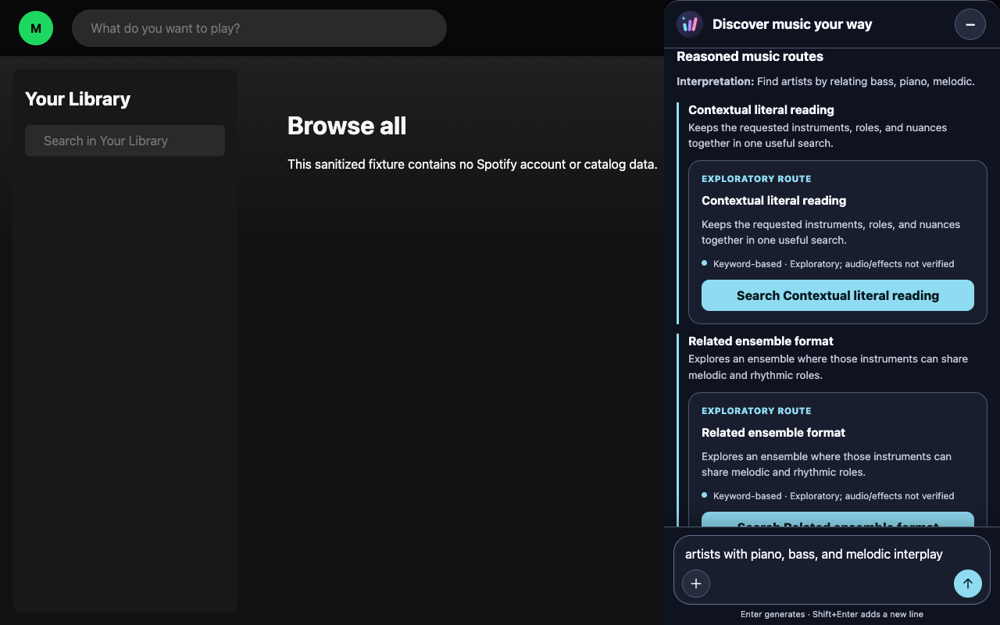
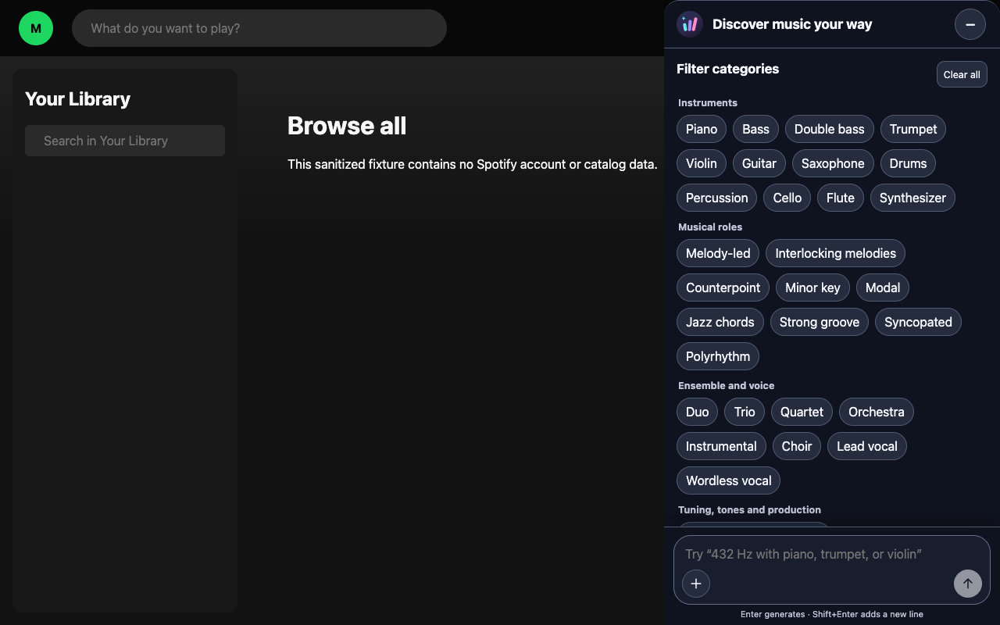
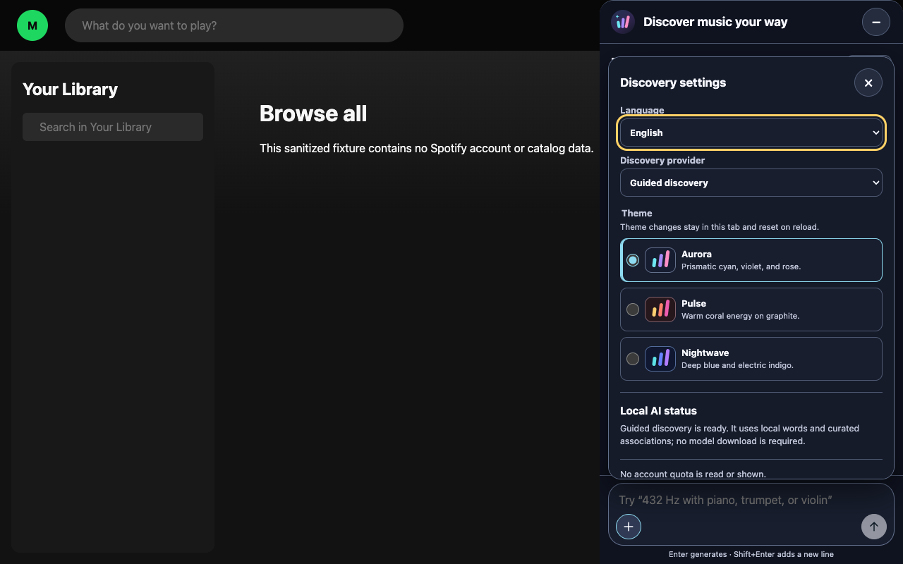

# Music Discovery Overlay

<p align="center">
  
</p>

Music Discovery Overlay is a privacy-first Chrome extension that turns musical characteristics into explainable Spotify Web searches. It runs locally, never reads a Spotify account, and requires a final user confirmation before searching.

> Independent open-source project. Not affiliated with or endorsed by Spotify or Google.

## Demo

The screenshots below come from the repository's sanitized fixture. They contain no Spotify account, profile, history, or catalog data.

<p align="center">
  
</p>

<details>
  <summary>See filters and the Aurora, Pulse, and Nightwave theme selector</summary>

  <p align="center">
    
  </p>

  <p align="center">
    
  </p>
</details>

## What it does

- Adds the independent prismatic **Aurora** launcher below Spotify's profile control and opens an English/Spanish discovery drawer.
- Includes three tab-scoped visual themes: the default **Aurora**, warm **Pulse**, and deep-blue **Nightwave**. Theme choice is never persisted.
- Accepts text, clickable traits, and local microphone input when the browser and device support it.
- Uses Chrome's on-device Prompt API as a local music curator, with an explicitly selected deterministic **Guided discovery** fallback.
- Organizes up to six primary recommendations into two or three distinct musical routes, with concise explanations and optional secondary examples.
- Labels evidence as **Spotify-supported**, **keyword-based**, or **AI-suggested**.
- Supports established A4 tuning references and exploratory tone keywords without attaching health, wellness, therapeutic, spiritual, or acoustic claims.
- Populates Spotify's own search field only after the user chooses **Search in Spotify**.

It does not authenticate with Spotify, call the Spotify Web API, inspect profiles, history, or playlists, control playback, click results, persist user input, or send telemetry.

## Install an unpacked release

When a GitHub Release is available:

1. Download `music-discovery-overlay-vX.Y.Z.zip` and its `.sha256` file.
2. Verify the checksum:

   ```bash
   shasum -a 256 -c music-discovery-overlay-vX.Y.Z.zip.sha256
   ```

   On Linux, `sha256sum -c` accepts the same checksum file.

3. Extract the ZIP into its own directory. That directory must contain `manifest.json` at its root.
4. Open `chrome://extensions` and enable **Developer mode**.
5. Choose **Load unpacked** and select the extracted directory.
6. Visit `https://open.spotify.com/`.

Only load code or release artifacts you trust. Updates are manual: replace the extracted directory with the newer verified release, choose **Reload** in `chrome://extensions`, and refresh every already-open Spotify tab.

## Build and load from source

Requirements:

- Node.js 24+
- npm 11+
- Chrome 149+

```bash
npm ci
npm run verify
npm run build
```

Then open `chrome://extensions`, enable **Developer mode**, choose **Load unpacked**, and select `dist/`. The generated `dist/` directory is intentionally not committed.

After rebuilding and reloading, refresh every already-open Spotify tab. Chrome injects manifest content scripts when a matching document loads; an older tab can otherwise retain the previous extension context until that page is refreshed.

## Try the sanitized fixture

```bash
npm run dev:mock
```

Open `http://127.0.0.1:4173/mock/`. This is the same account-free fixture used by the Playwright integration tests and README screenshots.

Regenerate the public screenshots from the fixture:

```bash
npm run screenshots
```

## Run end-to-end tests

The default command builds the real unpacked extension, starts or reuses the sanitized fixture, and runs all Playwright tests headlessly in one worker:

```bash
npm run test:e2e
```

Use Playwright's interactive UI to select tests, inspect each action and DOM snapshot, view traces, or enable watch mode:

```bash
npm run test:e2e:ui
```

Both commands accept Playwright filters after `--`:

```bash
npm run test:e2e -- e2e/discovery.spec.ts
npm run test:e2e:ui -- --grep "voice"
```

Playwright automatically starts `http://127.0.0.1:4173/mock/` when needed. A fixture already running locally is reused; CI always starts a clean instance. UI/watch mode serves the mock and frame source live, but the single unpacked-extension smoke uses the `dist/` built when the command started, so restart the command after source changes when validating that smoke.

## Local AI, voice, and Guided discovery

Chrome 149 is the minimum because this extension declares both English and Spanish for its Prompt API input and output contract. The extension checks local capability without creating a model session. If Chrome reports that a model can be downloaded, the extension explains what it enables before the user explicitly starts setup. Chrome may independently manage a shared model download; the extension does not claim that a capability check started it.

Once explicit setup begins, ordinary focus, visibility, drawer, and settings checks do not interrupt it. **Stop setup**, a provider or language change, and extension teardown still cancel the extension's preparation work safely. A background capability refresh also keeps already-ready controls mounted so keyboard focus is not lost.

Chrome owns shared-model removal. The settings flow links to Chrome's own model manager and explains that Chrome may retain an earlier broker state until the browser is fully restarted. The extension cannot inspect or delete model files itself.

If local AI is unavailable, **Guided discovery** remains a local deterministic option. It combines the complete request with curated musical associations and never invents artists or tracks. A local AI generation failure preserves the draft and offers an explicit retry or switch; it never silently changes providers.

Voice recording produces an editable transcript before suggestion generation. If the local model detects no usable speech, the prior draft remains unchanged and the extension reports that outcome without discarding its reusable sessions. Changing the draft, filters, language, or provider—and choosing **Clear all**—invalidates older work. Minimizing allows suggestion generation to continue, but cancels a pending microphone request or active recording and stops every audio track. Status changes remain available to assistive technology while the drawer is minimized.

No external AI provider, API key, remote inference service, account quota, telemetry, or persistent storage is used.

## Evidence and limitations

Spotify's documented search syntax supports fields such as `artist:`, `album:`, `track:`, `genre:`, `year:`, `label:`, and `tag:new`. Instruments, chord styles, tuning references, moods, specific tones, and user-requested health, spiritual, therapeutic, wellness, or acoustic language are exploratory search keywords or AI suggestions—not verified audio properties or effects.

Named artists, tracks, albums, playlists, genres, examples, and relationships proposed by local AI are exploratory starting points. The extension does not query a catalog to verify availability. Named suggestions compile to readable searches such as `An Ending (Ascent) — Brian Eno`; entity-free routes keep their musical context together instead of producing isolated keywords.

The tuning filters distinguish established musical contexts rather than presenting any frequency as universally optimal. `432 Hz` is available as an alternative A4 reference and an exploratory tone keyword. Other tone frequencies remain user-selected search terms without claims such as pain relief, DNA repair, energy influence, spiritual effects, or therapeutic outcomes.

See [Architecture](docs/ARCHITECTURE.md), [Privacy](docs/PRIVACY.md), [Threat model](docs/THREAT_MODEL.md), [test matrix](docs/TEST_MATRIX.md), [UI proposals](docs/UI_PROPOSALS.md), and [manual smoke test](docs/SMOKE_TEST.md).

## Development and releases

- `npm run verify` runs formatting, lint, strict TypeScript, Vitest, the production build, Playwright, and Axe coverage.
- Pull requests and `main` run the same validation in GitHub Actions.
- `npm run package` produces a deterministic unpacked-extension ZIP and SHA-256 checksum in ignored `artifacts/`.
- A version tag such as `v0.1.0` verifies, packages, and creates a GitHub Release using the repository-scoped `GITHUB_TOKEN`; no additional release secret is required.

See [Contributing](CONTRIBUTING.md), [Support](SUPPORT.md), [Security](SECURITY.md), and the [release guide](docs/RELEASING.md).

## License

Created and maintained by [Ibsen Gonzalez](https://github.com/ibsenjg). Released under the [MIT License](LICENSE).
