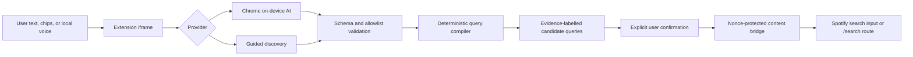

# Architecture

## Boundaries

The extension has three deliberately narrow contexts:

1. **Content bridge** — injected only on `https://open.spotify.com/*`. It reads only the rectangle of `button[data-testid="user-widget-link"]` to position the launcher, locates a visible search input when the user confirms a candidate, and otherwise ignores the page. It never reads the profile label, image, name, or attributes beyond the allowlisted test id.
2. **Extension-origin iframe** — owns all UI, selected filters, consent, `getUserMedia`/`MediaRecorder` voice capture, provider sessions, validation, and candidate generation. The iframe is placed inside a closed Shadow DOM host and receives `language-model; microphone` delegation.
3. **MV3 service worker** — exists only for lifecycle/startup verification. It stores and transmits nothing.

The iframe and content bridge use `postMessage` with a per-tab cryptographic nonce, exact source-window checks, allowlisted origins, and discriminated runtime field validation in both directions. The only page-data action is a non-empty validated search query of at most 200 characters. Spotify SPA mutation bursts and resize events are coalesced into one animation-frame positioning pass before the content bridge reads the allowlisted profile rectangle. Extension and iframe URLs are resolved once while the content-script runtime is valid rather than from later event handlers. Page exit, host replacement, or host removal disconnects observers, listeners, and pending animation frames; a fresh script instance replaces a stale DOM host, while a mount attempted after runtime invalidation removes the stale launcher and exits without throwing.

## Frame module ownership

`src/frame/App.tsx` is the composition root. It injects providers, connects the four domain hooks, coordinates the few cross-domain cancellations through typed callbacks, selects launcher versus drawer, and keeps one `StatusAnnouncer` mounted in either state. It does not implement Prompt API sessions, `MediaRecorder`, `AbortController`, or frame messaging directly.

| Module                | Owns                                                                                                                                                           | Does not own                                                          |
| --------------------- | -------------------------------------------------------------------------------------------------------------------------------------------------------------- | --------------------------------------------------------------------- |
| `useLocalAiLifecycle` | Capability reconciliation, background refresh, explicit preparation and progress, session release, model-manager flow, usage, operation ids, provider disposal | Drafts, recommendations, microphone streams, overlay focus            |
| `useDiscoverySession` | Composer text, selected traits, validated intent, candidates, generation, clarification, Clear all/Undo, generation cancellation and stale-result rejection    | Prompt baseline lifecycle, recording resources, frame bridge          |
| `useVoiceCapture`     | Consent, permission requests, `MediaRecorder`, stream tracks, recording timer, transcription, no-speech handling and voice-operation identity                  | Suggestion generation, Local AI preparation, drawer layout            |
| `useOverlayShell`     | Open/minimized state, settings visibility, parent bridge, Escape, focus restoration, viewport theme/locale markers and route-start scrolling                   | Provider/session resources, transcript parsing, candidate compilation |
| `components/*`        | Existing semantic DOM, accessible names, headings, controls, progress and visual grouping                                                                      | Browser APIs, providers and cross-domain state ownership              |

`appTypes.ts` contains frame-internal lifecycle types, while `appModel.ts` contains pure labels, capability mapping and candidate grouping. They deliberately do not alter the shared provider, intent, or bridge contracts. `LocalAiStatePanel` is the single renderer for Local AI states in both Settings and composer recovery; its variant changes placement, not lifecycle behavior.

### Frame styling

The React frame uses one `styled-components` `ThemeProvider` and one `GlobalStyle` around both launcher and drawer states. `AppTheme` defines Aurora, Pulse, and Nightwave as typed semantic palettes; `GlobalStyle` publishes the existing CSS custom properties from the selected object so component styles, forced-colors overrides, test diagnostics, and the `data-theme` marker share one source of truth. Theme state remains tab-scoped and resets to Aurora on reload.

Global reset, focus, system-color, and motion behavior lives under `src/frame/styles/`. Component-specific rules are module-scoped in colocated `*.styles.ts` files, and reusable controls, headings, the spinner, and visually-hidden content come from a small primitives module. Styled definitions are never created during render. Runtime interpolations are limited to typed theme values, booleans, media constants, and static theme previews; user text, model output, Spotify queries, and URLs never become CSS.

The styles are injected into the extension-origin iframe document, not Spotify or the content-script Shadow DOM. The manifest CSP remains unchanged and does not require a nonce, `StyleSheetManager`, remote CSS, or an unsafe directive. A small set of explicit static classes remains only as temporary geometry/test contracts; generated styled-components hashes are not contracts. The sanitized Spotify mock keeps its independent `mock.css`, while the non-React content bridge retains its narrow dynamic inline positioning.

Cross-domain cancellation remains explicit:

| Trigger                                            | Suggestion generation              | Pending permission/recording                 | Transcription already processing                           | Local AI preparation                                             |
| -------------------------------------------------- | ---------------------------------- | -------------------------------------------- | ---------------------------------------------------------- | ---------------------------------------------------------------- |
| Start a new recording                              | Cancel                             | Replace with the new voice operation         | Reject stale completion                                    | Preserve                                                         |
| Minimize                                           | Continue in background             | Cancel and stop tracks                       | Continue, then reject only if superseded                   | Preserve                                                         |
| Edit or Clear all                                  | Cancel and reject stale completion | Cancel through the initiating UI action      | Reject stale completion                                    | Preserve                                                         |
| Toggle filters                                     | Cancel and reject stale completion | Preserve                                     | Continue and apply the transcript with the current filters | Preserve                                                         |
| Change provider or locale                          | Cancel and reject stale completion | Cancel and stop tracks                       | Reject stale completion                                    | Cancel and dispose                                               |
| Focus, visibility, Settings open, or drawer reopen | Preserve                           | Preserve unless another privacy rule applies | Preserve                                                   | Preserve; ordinary capability refresh is skipped while preparing |
| Stop setup or open model manager                   | Cancel affected Local AI work      | Cancel                                       | Reject stale Local AI completion                           | Cancel and dispose                                               |
| Unmount                                            | Cancel and dispose                 | Cancel and stop tracks                       | Reject completion                                          | Cancel and dispose                                               |

Each hook owns and cleans only its own operation ids, controllers, sessions, streams, event handlers, or timers. This keeps late browser/provider results from repopulating state after the user has moved to a newer action.

## Discovery contracts

- `DiscoveryIntent` contains the inferred target, locale, concise interpretation, native Spotify fields, free terms, grouped musical traits, two or three reasoned routes, and an optional clarification.
- Each route has a title, rationale, contextual backup terms, and typed recommendations. A recommendation has a type, name, optional associated artist, concise explanation, evidence kind, and up to two secondary examples. Runtime validation removes unknown fields and deduplicates routes, entities, and examples while allowing no more than six primary recommendations.
- `TraitGroup` preserves `AND`/`OR` intent. “Piano, trumpet, or violin” remains one `OR` group.
- `ProviderCapabilities` reports text and audio availability separately.
- `IntentProvider` exposes capability checks, explicit `prepare`, text/audio parsing, cancellation, usage, and disposal without giving providers DOM access. Text and audio availability checks use the same modality/language declarations as their session creation.
- `ProviderUsage` reports only the Prompt API session's context usage/window. It is explicitly not an account, billing, or rate quota.
- `SpotifySearchAdapter` recognizes only Spotify's allowlisted global-search markers (currently `data-testid="search-input"` plus bilingual global-search labels), never a generic `role="searchbox"`. Spotify's separate **Search in Your Library** field is therefore not a candidate. If the global field cannot be identified confidently, the adapter fails to the encoded `/search/...` route.

The model never supplies executable actions or final DOM commands. It produces a candidate data structure, which is sanitized, validated, and compiled by deterministic code. Artist entities become their readable names, while tracks and albums with a known artist become `Title — Artist`; entity-free routes remain one contextual search. Named entities and musical relationships stay visibly exploratory because no Spotify catalog or audio analysis is consulted.

## State and lifecycle

All state lives in the iframe's JavaScript memory. There is no `chrome.storage`, IndexedDB, localStorage, sessionStorage, cookie, analytics, or backend. A page reload or tab close destroys prompts, filters, candidates, transcript drafts, provider selection, theme selection, consent, progress, and usage. Theme changes select an in-memory typed theme and update the extension document's `data-theme` marker; both default back to Aurora on reload. Prompt API sessions, recording timers, and microphone tracks are explicitly disposed on unmount. Voice permission requests have their own operation identity: minimizing, clearing, changing provider/language, losing capability, or unmounting invalidates a pending request, and any stream that resolves late is stopped before a `MediaRecorder` can be created. Recorder errors share the same idempotent timer/track cleanup path.

Capability checks never call `LanguageModel.create()`. Chrome 149 is the minimum supported browser because the provider declares English and Spanish in the same multilingual Prompt API contract. When text is `downloadable` or already `downloading`, a requirement step distinguishes Chrome's shared model activity from extension session creation, names the dependent features, and keeps **Guided discovery** available without the model. Explicit activation of **Download local AI** or **Continue and show progress** calls `prepare()` with a named, full-width progress indicator. **Stop setup** aborts extension preparation without claiming to cancel Chrome's shared download. Audio sessions are created lazily only when audio is already reported available and a consented recording needs transcription. Audio parsing returns a sanitized non-empty transcript only; a no-speech result leaves the existing composer draft and reusable baselines intact. Structured intent is created later when the user submits the composer.

Local-AI UI is driven by one discriminated state: `checking`, `downloadable`, `download-in-progress`, `ready-text`, `ready-text-audio`, `unavailable`, or `error`. Capability checks run on initial load, drawer open, settings open, visible-document changes, window focus, and Prompt API failure. A shared in-flight promise deduplicates ordinary concurrent triggers; forced checks receive a monotonically increasing request id, and only the newest result may update controls. Ordinary focus, visibility, drawer, and settings checks are skipped while explicit preparation is active, so they cannot dispose its baseline. Preparation has its own operation id and abort controller; explicit cancellation, provider/language changes, model-management actions, or unmount invalidate it and ignore any late progress or completion. When the provider is already ready, ordinary background checks preserve the mounted controls and keyboard focus while verifying capability. This prevents both interrupted downloads and a late `available` response from re-enabling microphone or generation after a newer `downloadable` or `unavailable` result.

One in-flight initialization promise per modality prevents concurrent callers from creating and orphaning duplicate baseline sessions. The text baseline has a locale-neutral system instruction; every independent task payload supplies its current `locale`. Each baseline is cloned with the task's cancellation signal for an independent transcription or intent request, and the task clone is destroyed after completion. This prevents prior requests from accumulating in the next search while keeping the model warm. If an active Prompt API call fails, the extension treats its earlier capability result as stale: it destroys the local sessions, immediately checks Chrome again, preserves the user's draft, and offers retry or an explicit **Use Guided discovery** action. A `downloadable` result restores the explicit **Download local AI** state; `unavailable` or `error` keeps local-AI controls disabled. `LanguageModel.create()` is never attempted while Chrome reports `unavailable`; the extension never silently switches providers after a generation error.

Suggestion and transcription operations also carry monotonically increasing identities. Draft, provider, locale, and Clear-all changes abort affected active work and reject late completions even when a provider ignores its `AbortSignal`; filter changes cancel only suggestion generation, so a transcript already processing can finish against the current filters. Minimizing is the intentional exception for suggestion generation and transcription already processing, which may complete in the background; pending permission and active recording are cancelled, their transient feedback is cleared, and microphone capture never continues while minimized. One screen-reader status region remains mounted in both expanded and minimized states and announces changes, while visible notices remain ordinary text. The first-use microphone disclosure is an accessible modal with contained keyboard focus and Escape focus restoration.

Session release and model removal are intentionally distinct. `LanguageModelSession.destroy()` releases this tab's resources; it does not remove Chrome's shared model. The removal trigger is absent while its controlled panel is open and is restored before focus returns on close. Opening the removal manager aborts active local work, destroys the extension's sessions, and opens `chrome://on-device-internals` with no added manifest permission. In current Manifest Broker builds, the user completes Chrome's privileged **Broker State → Uninstall Models** action there; some builds label it **Delete models**. JavaScript cannot inspect the model files or query their version, and a same-process Prompt API availability result is not presented as deletion verification. After Models reaches 0 B/0 KB, the sole completion path is to quit every Chrome process and reopen the browser. Initial extension startup then performs the normal capability check against the fresh browser process.

## Future providers

`futureProviders.ts` documents disabled OpenAI and Anthropic adapters. Enabling either requires a separate design review covering official API authentication, optional host permissions, secrets, disclosure, quota semantics, and tab-scoped cleanup. Consumer ChatGPT/Claude subscriptions must not be presented as API access.
